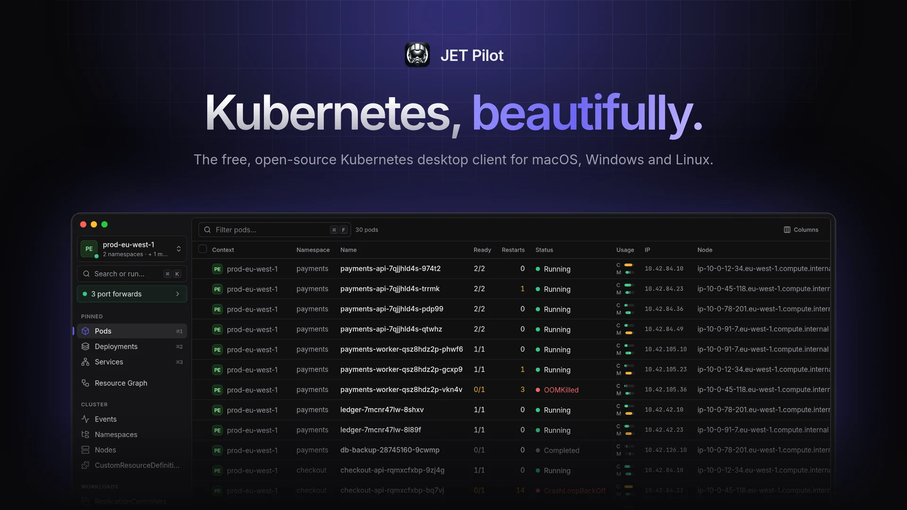
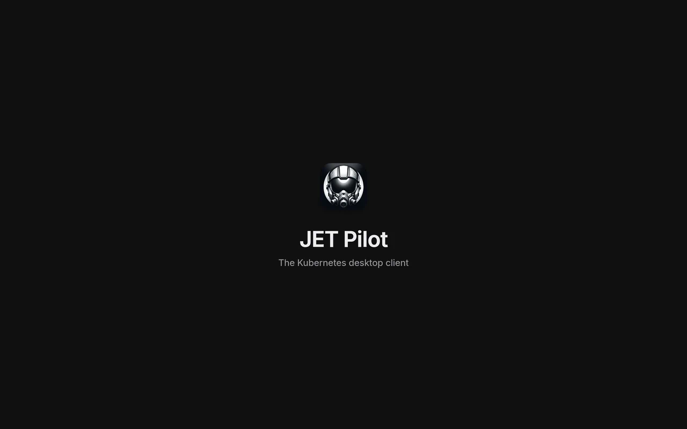

# JET Pilot

<p align="center">
  <picture>
    <source media="(prefers-color-scheme: dark)" srcset="public/header-dark.webp">
    <source media="(prefers-color-scheme: light)" srcset="public/header-light.webp">
    
  </picture>
</p>

<p align="center">
  <b>The open-source Kubernetes IDE that focuses on less clutter, speed and good looks.</b><br/>
  Free · MIT licensed · macOS (Apple Silicon and Intel), Windows (x64) and Linux (x64 and ARM64) · <a href="https://www.jet-pilot.app">jet-pilot.app</a>
</p>

## Introduction
JET Pilot is an open-source K8s IDE. It was created out of frustration, as all "good-looking" K8s IDEs went commercial. Power-users nowadays resort to tools like `k9s`, which works great, but heavily relies on keyboard input. JET Pilot combines a keyboard-first workflow with a polished, mouse-friendly desktop UI — built with Rust and Tauri, so it stays small and fast.

No account, no telemetry: JET Pilot uses your existing kubeconfig files and `kubectl`, and connects your cloud accounts when you want it to.

## A quick tour

<p align="center">
  
</p>

## What's new in 2.2
- **GitOps**: one page for every Flux Kustomization, Flux HelmRelease and Argo CD Application across your clusters, problems first. Open a delivery to see its source, what it delivered and why it fails; reconcile, suspend, sync or refresh it from there.
- **Usage history**: CPU and memory charts (plus network for pods) over 1h, 6h, 24h or 7d in the side panel of pods, workloads, nodes and namespaces, with requests and limits drawn in. JET Pilot finds the cluster's Prometheus, Thanos Query or VictoriaMetrics by itself and queries it through the API server, so there's nothing to port-forward. Without one, the charts show metrics-server's last 15 minutes.
- **Access review**: ask "Can I delete deployments in payments?" or "Who can…?" and get an answer with the binding and role behind it, or see everything a user, group or service account may do. Roles, bindings and service accounts get side panels that read like sentences.
- **Native Helm**: releases and their history load straight from the cluster, without the `helm` binary. A release panel shows notes, resources, values and a revision timeline that says what changed, with rollback and compare. Search your repositories and Artifact Hub, then install with a values editor checked against the chart's schema and a dry-run preview.
- **Side panels that explain**: every panel opens with the object's state in a sentence, links to related objects and has sections for pods, nodes, services, ingresses, storage, HPAs, jobs, cron jobs, config maps and namespaces. Edit labels, annotations and node taints in place, with a preview before you save. Describe and YAML now come from the API, so they work without `kubectl`.
- **Operators and CRDs**: every custom resource shows its CRD's printer columns, and well-known projects get their own sidebar sections. cert-manager, Gateway API, Karpenter, KEDA, External Secrets and Prometheus Operator get curated columns, states in words and side panels, with actions such as Renew, Pause and Sync now.
- **Port forwards that heal**: forwards run over the Kubernetes API and follow their pod through restarts and rollouts. Ports show by name, local ports are predictable, and an HTTP tester sends requests to a forward.
- **Custom actions**: one small YAML file per action (open a URL, run a command or `kubectl`, exec into a container, apply a patch, copy text), shown in row menus, the side panel and the command palette. Values from the cluster never become code, and actions that change the cluster go through the guardrails.

## Features
- **Clusters hub**: every cluster from every kubeconfig and cloud account in one list, with live status, names, colours, folders and tags. Connect AWS, Google Cloud, Azure, DigitalOcean, Akamai/Linode, Civo, Scaleway, Vultr and Exoscale, or paste, import or enter a cluster by hand; credentials live in your system keychain.
- **Production guardrails**: protected clusters ask you to type the name before destructive actions; read-only clusters can't be changed from JET Pilot.
- **Multi-cluster & multi-namespace**: connect to several contexts (across multiple kubeconfig files) and namespaces at once; every table aggregates them with Context and Namespace columns.
- **Built-in terminal**: open a local terminal (<kbd>Ctrl</kbd>+<kbd>`</kbd>) with `kubectl` preconfigured for the current context — your own kubeconfig is never modified. Shell into any container with one click, on macOS, Linux and Windows.
- **Resource graph**: see how Services, Deployments, ReplicaSets, Pods, ConfigMaps and Secrets relate, with live health indicators.
- **Structured log viewer**: follow logs, parse JSON log lines into fields and filter them with facets.
- **Object management**: browse, describe, create and edit any Kubernetes object in a full YAML editor (<kbd>Cmd</kbd>/<kbd>Ctrl</kbd>+<kbd>S</kbd> to apply).
- **Command palette**: <kbd>Cmd</kbd>/<kbd>Ctrl</kbd>+<kbd>K</kbd> to jump anywhere, switch contexts and namespaces or open a terminal — with fuzzy search.
- **GitOps**, **usage history**, **access review**, **Helm**, self-healing **port forwards** and **custom actions** (see above), plus events, scaling, rollouts, cordon/drain and more.
- **SSO-friendly**: in-app sign-in for AWS IAM Identity Center, gcloud, az, kubelogin/OIDC and other exec plugins, with device codes shown in the app.
- **A premium, accessible UI** with polished dark and light themes.

## Installation

Download the latest release for your platform from the [releases page](https://github.com/unxsist/jet-pilot/releases/latest/) or from [jet-pilot.app](https://www.jet-pilot.app). JET Pilot updates itself automatically.

JET Pilot uses [`kubectl`](https://kubernetes.io/docs/tasks/tools/) for some tasks, and `helm` to install, upgrade and roll back charts (browsing releases doesn't need it). When they aren't on your `PATH`, it can download them for you, verified against their official checksums (Settings › Advanced).

### macOS

Install with Homebrew from the JET Pilot tap:

```bash
brew install --cask unxsist/tap/jet-pilot
```

The tap's cask clears macOS's quarantine flag after installing, so the app opens right away and keeps itself up to date.

> [!NOTE]
> JET Pilot is no longer in Homebrew's main cask repository: since October 2026 Homebrew only accepts apps notarized by Apple there. If you installed it with `brew install --cask jet-pilot` before, switch once with `brew uninstall --cask jet-pilot && brew install --cask unxsist/tap/jet-pilot` (your settings are kept).

…or download the `.dmg` for Apple Silicon (`aarch64`) or Intel (`x64`), open it and drag JET Pilot into your Applications folder.

> [!IMPORTANT]
> **JET Pilot is not notarized by Apple.** It's free and open source, and we'd rather not pay Apple's yearly developer fee. When you install the `.dmg` yourself, macOS will say the app *"is damaged and can't be opened"* or *"cannot be verified"*. Remove the quarantine flag once after installing:
>
> ```bash
> xattr -dr com.apple.quarantine "/Applications/JET Pilot.app"
> ```
>
> That's it — automatic updates keep working afterwards. (The Homebrew tap does this for you.)

### Linux

Packages are available for x64 (`amd64` / `x86_64`) and ARM64 (`aarch64`):

- **Debian / Ubuntu**: `sudo apt install ./JET.Pilot_<version>_<arch>.deb`
- **Fedora / RHEL / openSUSE**: `sudo rpm -i JET.Pilot-<version>-1.<arch>.rpm`
- **AppImage** (any distribution): `chmod +x JET.Pilot_<version>_<arch>.AppImage` and run it.

### Windows

Download the `.exe` (or `.msi`) installer and run it. The installer isn't code-signed, so Windows SmartScreen may warn you — click **More info → Run anyway**.

## Contributing

Issues and pull requests are very welcome! JET Pilot is built with [Tauri v2](https://tauri.app) (Rust) and [Vue 3](https://vuejs.org).

```bash
npm ci
npm run dev             # run the app
npx vitest run          # unit tests
npm run harness         # UI in the browser with mocked cluster data (no cluster needed)
```

Commits follow [Conventional Commits](https://www.conventionalcommits.org); releases are created with semantic-release.

## License

[MIT](LICENSE)
